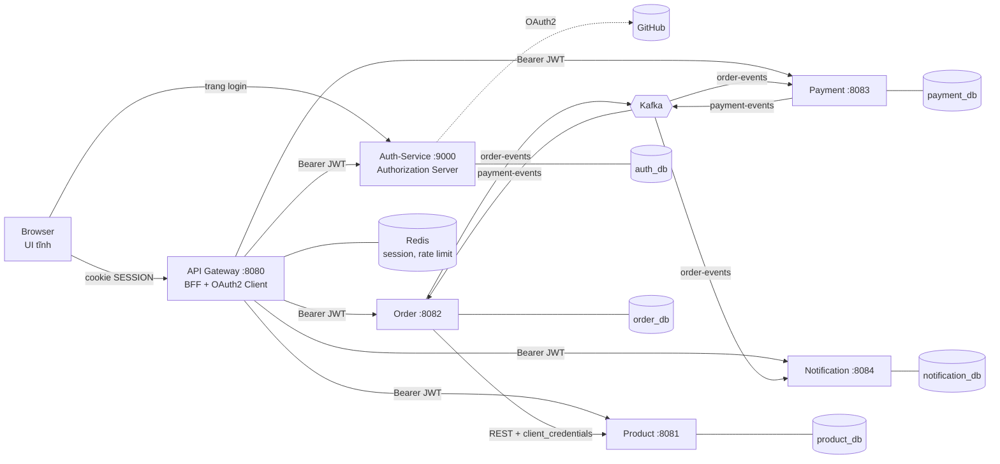
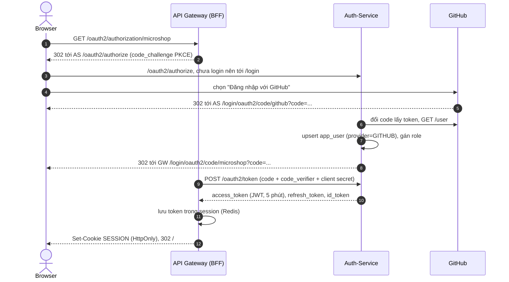
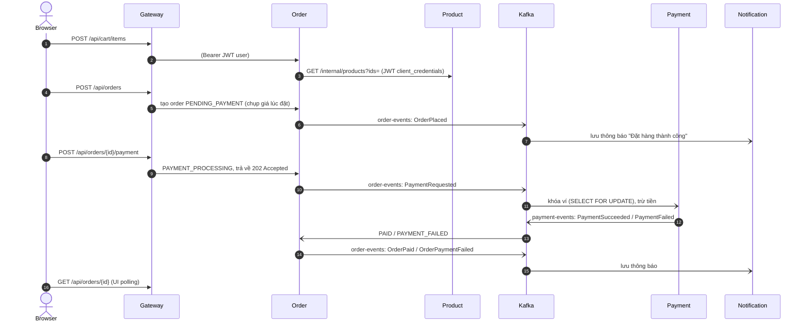

# MicroShop: demo Microservices cho sinh viên
## Updated by minhbui

Một shop bán hàng nhỏ, đủ để thấy toàn cảnh một hệ thống microservices: **API Gateway, SSO và phân quyền, REST giữa các service, event qua Kafka, database riêng cho từng service, metrics và log tập trung**.
Nghiệp vụ được giữ tối giản để sinh viên tập trung vào **cách các service vận hành với nhau**.

| | |
|---|---|
| Ngôn ngữ / Framework | Java 25, Spring Boot 4.1.2, Spring Cloud 2025.1.x (Gateway), Spring Authorization Server |
| Hạ tầng | PostgreSQL 18, Apache Kafka 4.2 (KRaft), Redis 8 |
| Observability | Prometheus + Grafana (metrics), Elasticsearch + Logstash + Filebeat + Kibana (logs), Micrometer Tracing (traceId) |
| Triển khai | Docker, Docker Compose |

---

## 1. Kiến trúc



| Service | Port | Database | Vai trò |
|---|---|---|---|
| api-gateway | 8080 | Redis (session) | Cổng vào duy nhất. Phục vụ UI, login OAuth2 (BFF), gắn token, route, rate limit, circuit breaker |
| auth-service | 9000 | auth_db | SSO: login GitHub hoặc tài khoản demo, cấp JWT có claim `roles`, quản lý user và quyền |
| product-service | 8081 | product_db | CRUD sản phẩm (xem public, sửa cần ADMIN) |
| order-service | 8082 | order_db | Giỏ hàng, đặt đơn, gọi Product qua REST, publish và consume event Kafka |
| payment-service | 8083 | payment_db | Ví (Wallet): trừ tiền khi nhận `PaymentRequested`, trả kết quả qua Kafka |
| notification-service | 8084 | notification_db | Nghe event đơn hàng, lưu và log thông báo |

**Database per service:** mỗi service có **1 container Postgres riêng** (`auth-db`, `product-db`, `order-db`, `payment-db`, `notification-db`), với volume, user và mật khẩu riêng. Service chỉ biết địa chỉ DB của chính nó (`DB_HOST`). Muốn lấy dữ liệu của service khác thì phải gọi API hoặc nghe event, không thể đọc thẳng database của nhau.

| Container | Database / user / mật khẩu | Port trên máy host |
|---|---|---|
| auth-db | `auth_db` / `auth_svc` / `auth_pwd` | 5432 |
| product-db | `product_db` / `product_svc` / `product_pwd` | 5433 |
| order-db | `order_db` / `order_svc` / `order_pwd` | 5434 |
| payment-db | `payment_db` / `payment_svc` / `payment_pwd` | 5435 |
| notification-db | `notification_db` / `notification_svc` / `notification_pwd` | 5436 |

Có thể mở từng DB bằng DBeaver/pgAdmin qua port trên, hoặc `docker compose exec order-db psql -U order_svc -d order_db`.

---

## 2. Chạy trên máy local

Yêu cầu: JDK 25, Docker Desktop (hoặc Docker Engine + Compose v2), RAM trống khoảng **6 GB** cho core hoặc **9 GB** nếu bật thêm observability.

```bash
# 1. Build jar (Dockerfile copy jar có sẵn để build image nhanh)
./mvnw clean package -DskipTests

# 2a. Chỉ chạy core: 6 service + 5 Postgres, Kafka, Redis, Kafka UI
docker compose up -d --build

# 2b. Hoặc chạy kèm Prometheus, Grafana, ELK
docker compose --profile observability up -d --build

# Theo dõi
docker compose ps
docker compose logs -f order-service payment-service notification-service

# Dừng và xóa sạch dữ liệu
docker compose --profile observability down -v
```

> Log trong container ở dạng JSON (ECS) để đẩy vào ELK. Khi chạy service trong IDE (không đặt `LOG_FORMAT`), log hiển thị dạng text bình thường. Tất cả cấu hình mặc định đều trỏ về `localhost`, nên có thể `docker compose up -d auth-db product-db order-db payment-db notification-db kafka redis` rồi chạy từng service trong IDE (mỗi service mặc định nối tới đúng port DB của mình, 5432 đến 5436).

### Địa chỉ

| URL | Mô tả |
|---|---|
| http://localhost:8080 | **Ứng dụng** (UI + `/api/**`) |
| http://localhost:9000 | Auth-service: trang login, `/.well-known/openid-configuration` |
| http://localhost:8090 | Kafka UI: xem topic `order-events`, `payment-events`, consumer group |
| http://localhost:3000 | Grafana: dashboard *MicroShop overview* (xem không cần login, sửa dùng admin/admin) |
| http://localhost:9090 | Prometheus: Status, Targets |
| http://localhost:5601 | Kibana: Discover, data view *MicroShop logs* |
| http://localhost:8081/swagger-ui.html | Swagger của product-service (port duy nhất của service nghiệp vụ được mở ra ngoài) |

### Tài khoản

| Tài khoản | Quyền | Ghi chú |
|---|---|---|
| `user` / `user` | USER | Tài khoản demo |
| `admin` / `admin` | USER, ADMIN | Tài khoản demo, thấy tab *Quản trị* |
| GitHub | USER (hoặc ADMIN nếu có trong `ADMIN_GITHUB_LOGINS`) | Cần tạo OAuth App, xem mục 3 |

Mỗi user mới có sẵn **20.000.000 đ** trong ví. Laptop giá 25.990.000 đ, nên mua Laptop là cách nhanh nhất để thấy luồng **thanh toán thất bại**.

---

## 3. Login SSO qua GitHub

1. Vào GitHub, chọn **Settings → Developer settings → OAuth Apps → New OAuth App**:
   - Homepage URL: `http://localhost:8080`
   - Authorization callback URL: `http://localhost:9000/login/oauth2/code/github`
2. Copy `.env.example` thành `.env` rồi điền `GITHUB_CLIENT_ID`, `GITHUB_CLIENT_SECRET`. Có thể đặt `ADMIN_GITHUB_LOGINS=<github-username>` để tài khoản đó thành ADMIN.
3. Chạy `docker compose up -d auth-service` để nạp lại biến môi trường.

Callback trỏ về **auth-service (9000)**, không phải gateway. Gateway không biết GitHub tồn tại: nó chỉ tin Auth-Service. Auth-Service mới là nơi *federate* sang GitHub, rồi phát JWT của riêng hệ thống.



---

## 4. API Gateway và Auth-Service: các điểm "chuẩn chỉnh"

**Auth-Service** ([auth-service](auth-service)):

| Điểm | Ở đâu |
|---|---|
| Spring Authorization Server, OIDC (discovery, userinfo, logout) | `config/AuthorizationServerConfig` |
| Client, authorization, consent lưu **JDBC** (restart không mất phiên) | `JdbcRegisteredClientRepository`, `JdbcOAuth2AuthorizationService` |
| Khóa ký RSA lưu DB (restart không làm token cũ mất hiệu lực) | `config/SigningKeyStore` |
| Federated login GitHub, đồng bộ user nội bộ, `sub` = UUID nội bộ (không phụ thuộc provider) | `user/GithubOAuth2UserService` |
| JWT có claim `roles`, client service nhận `roles=[SERVICE]` | `tokenCustomizer` |
| 2 client: `api-gateway` (authorization_code + PKCE + refresh) và `order-service` (client_credentials) | `config/BootstrapData` |
| Admin đổi quyền user qua API | `PUT /api/admin/users/{id}/roles` |

**API Gateway** ([api-gateway](api-gateway)) theo mẫu **BFF (Backend for Frontend)**:

| Điểm | Giải thích |
|---|---|
| Browser **không bao giờ cầm token** | Token nằm trong session ở Redis. Browser chỉ có cookie `SESSION` (HttpOnly) |
| `TokenRelay` | Gateway tự gắn `Authorization: Bearer <JWT>` khi forward, và tự refresh khi token hết hạn |
| CSRF | Vì dùng cookie nên bật CSRF: cookie `XSRF-TOKEN` và header `X-XSRF-TOKEN` (xem `app.js`) |
| Phân quyền 2 lớp | Gateway chặn sớm `/api/admin/**`. **Service vẫn tự kiểm tra JWT** (zero trust, không tin mạng nội bộ) |
| Rate limit theo user | `RequestRateLimiter` + Redis (20 req/s, burst 40) |
| Circuit breaker + fallback | Service chết thì trả `503 ProblemDetail` ngay, không treo request |
| Retry chỉ cho GET | Không retry POST để tránh đặt đơn hoặc trừ tiền 2 lần |
| Logout chuẩn OIDC | Xóa session gateway, gọi `end_session_endpoint` của Auth-Service |
| `RemoveRequestHeader=Cookie` | Cookie của browser không lọt xuống service phía sau |

---

## 5. Luồng đặt hàng và thanh toán (REST + Kafka)



| Topic | Producer | Consumer | Event |
|---|---|---|---|
| `order-events` (key = orderId) | order | payment, notification | `OrderPlaced`, `PaymentRequested`, `OrderPaid`, `OrderPaymentFailed` |
| `payment-events` (key = orderId) | payment | order | `PaymentSucceeded`, `PaymentFailed` |
| `*-dlt` | Spring Kafka | (người vận hành) | message lỗi sau 3 lần retry |

Điểm cần cho sinh viên thấy:

- **Tại sao POST payment trả về 202?** Thanh toán là bất đồng bộ. Client hỏi lại trạng thái (polling).
- **Key = orderId**: mọi event của 1 đơn vào cùng partition nên giữ đúng thứ tự.
- **Idempotency**: Kafka giao *at-least-once*. Payment và Notification lưu `event_id` UNIQUE, nhận trùng thì bỏ qua (Payment gửi lại kết quả cũ).
- **Publish sau commit** (`@TransactionalEventListener(AFTER_COMMIT)`): không gửi event cho dữ liệu đã rollback. Đổi lại vẫn có thể mất event nếu service chết giữa commit và send. Đây là chỗ để giới thiệu **Transactional Outbox** (bài tập nâng cao).
- **Event dùng chung** trong module `common-events` (sealed interface + JSON `type`). Thực tế nhiều team dùng schema registry thay cho jar dùng chung, nên đây là chỗ để thảo luận trade-off.
- **Service-to-service auth**: Order gọi Product bằng token `client_credentials` (role `SERVICE`), không dùng token của user.

---

## 6. Observability

| Câu hỏi | Công cụ | Thử |
|---|---|---|
| Service nào đang sống? Bao nhiêu đơn, bao nhiêu lần thanh toán lỗi? | Grafana (http://localhost:3000) | Dashboard *MicroShop overview*: `microshop_orders_placed_total`, `microshop_payments_total{result}`, request/s, latency, Kafka listener, circuit breaker |
| Prometheus kéo metrics ở đâu? | http://localhost:9090/targets | Mỗi service có `/actuator/prometheus` |
| Một đơn hàng đã đi qua những service nào? | Kibana, Discover | Tìm log `PaymentRequested`, copy `traceId`, rồi filter `traceId: "<id>"`: thấy log của order, payment, notification **cùng 1 traceId** (trace đi xuyên qua Kafka header) |
| Log lỗi của service X | Kibana | `service: "payment-service" and level: "ERROR"` |

Đường đi của log: service ghi JSON ra stdout, Docker lưu thành file, **Filebeat** đọc (chỉ container có label `microshop.logs=true`), gửi **Logstash** parse field (`service`, `level`, `traceId`...), rồi ghi **Elasticsearch**, xem bằng **Kibana**.

---

## 7. Gợi ý bài lab

| Lab | Làm gì | Quan sát |
|---|---|---|
| Circuit breaker | `docker compose stop product-service`, rồi mở tab Sản phẩm | Gateway trả 503 ngay, Grafana panel circuit breaker chuyển OPEN. Start lại thì tự phục hồi |
| Kafka bền vững | `docker compose stop payment-service`, đặt đơn rồi bấm thanh toán, sau đó start lại | Đơn ở `PAYMENT_PROCESSING`, event nằm chờ trong Kafka (Kafka UI: consumer lag), start lại thì đơn thành `PAID` |
| Scale consumer | `docker compose up -d --scale notification-service=3` | Kafka UI: 3 consumer chia nhau 3 partition |
| Phân quyền | Gọi `/api/admin/orders` bằng user thường, rồi admin cấp quyền ADMIN cho user (tab Quản trị) và login lại | 403, sau đó 200 (quyền nằm trong JWT nên phải login lại mới có token mới) |
| Zero trust | `curl -i localhost:8081/api/products` (OK, public) rồi `curl -i -X POST localhost:8081/api/products` | Gọi thẳng service, bỏ qua gateway vẫn bị 401: service tự validate JWT |
| Database per service | `docker compose stop payment-db`, rồi xem sản phẩm, thêm giỏ hàng, đặt đơn và bấm thanh toán | Sản phẩm, giỏ hàng, đặt đơn vẫn chạy. Chỉ phần thanh toán hỏng: payment-service log lỗi kết nối DB, đơn kẹt ở `PAYMENT_PROCESSING`. Lỗi của 1 DB không kéo sập cả hệ thống. So sánh thêm: `docker compose exec order-db psql -U order_svc -d order_db -c '\dt'` chỉ thấy bảng của order, không có bảng ví |
| Idempotency | Kafka UI: produce lại 1 message `PaymentRequested` cũ | Ví không bị trừ 2 lần |
| Mở rộng | Viết Transactional Outbox cho order-service, hoặc thêm inventory-service | |

Test tự động toàn luồng (stack đang chạy):

```bash
cd scripts && npm install && npx playwright install chromium && npm run e2e
```

Script đi qua: xem sản phẩm khi chưa login, login SSO, giỏ hàng, đặt đơn, thanh toán OK, thanh toán thất bại do thiếu tiền, nạp tiền rồi thanh toán lại, thông báo, quyền admin, CSRF, logout.

---

## 8. Cấu trúc thư mục

```text
microshop/
├── common-events/          # event Kafka dùng chung (record + sealed interface)
├── auth-service/           # Spring Authorization Server + GitHub login
├── api-gateway/            # Spring Cloud Gateway (BFF) + UI tĩnh (static/)
├── product-service/
├── order-service/          # cart/, order/, client/ (REST tới product), messaging/ (Kafka)
├── payment-service/
├── notification-service/
├── docker/
│   ├── service.Dockerfile  # 1 Dockerfile dùng chung, ARG MODULE
│   ├── prometheus/ grafana/ logstash/ filebeat/
├── scripts/e2e.js
└── docker-compose.yaml
```

## 9. Giới hạn (cố ý, vì là demo)

- Secret (client secret, mật khẩu DB) để trong `application.yml` và compose. Production dùng Vault hoặc K8s Secret.
- Elasticsearch tắt security, tắt ngưỡng ổ đĩa.
- Không có Service Discovery (Eureka) hay Config Server: Docker DNS đủ cho local. Nên giới thiệu như bước tiếp theo, cùng với Kubernetes Service.
- 1 broker Kafka, replication factor 1.

### END